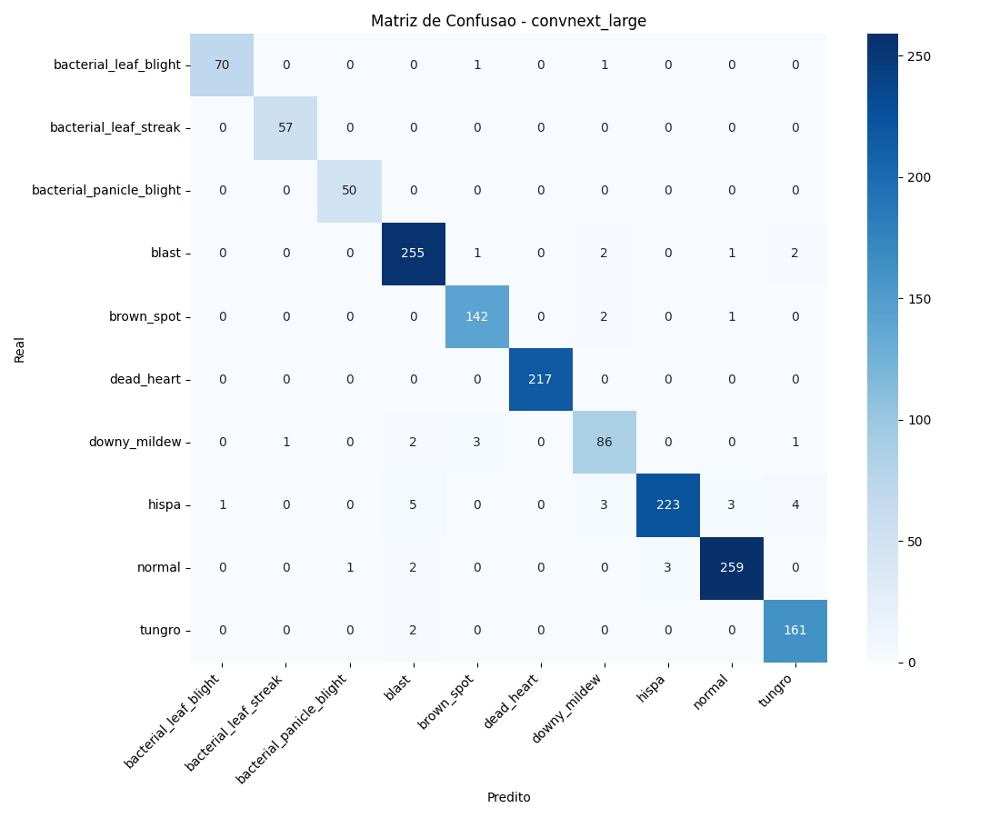
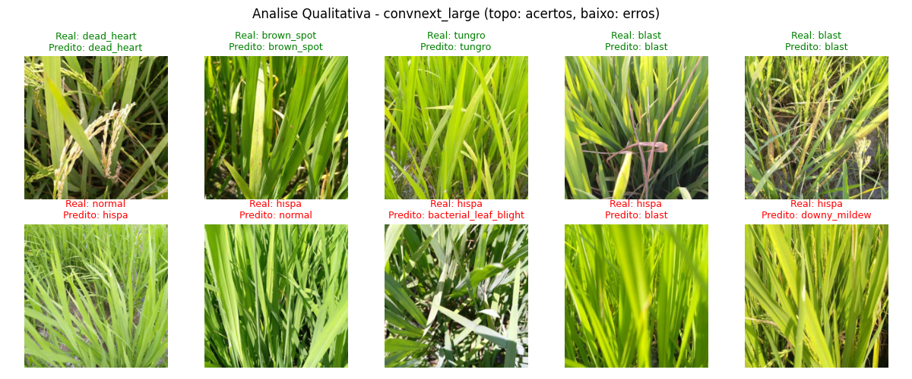

# Classificação de doenças do arroz com redes neurais convolucionais

Trabalho da disciplina **SIN 393 – Introdução à Visão Computacional** (UFV, *campus* Rio Paranaíba, 2026).

O projeto treina e compara seis redes neurais convolucionais (CNNs) pré-treinadas no ImageNet na classificação de
imagens de plantas de arroz em **10 classes**: nove doenças ou pragas e a classe de plantas saudáveis. As imagens
foram tiradas no campo, com celular, e têm fundo complexo, iluminação variável e várias plantas no mesmo quadro.

As redes pertencem a três famílias, cada uma em dois tamanhos, o que permite separar o efeito da **família da
arquitetura** do efeito do **tamanho do modelo**:

| Família | Modelo menor | Modelo maior |
|---|---|---|
| MobileNetV3 | MobileNetV3-Small | MobileNetV3-Large |
| ResNet | ResNet-18 | ResNet-50 |
| ConvNeXt | ConvNeXt-Tiny | ConvNeXt-Large |

📺 **Vídeo de apresentação:** _(adicionar o link do YouTube)_

---

## Dataset

São usadas as 10.407 imagens rotuladas de treino da competição
[Paddy Disease Classification](https://www.kaggle.com/competitions/paddy-disease-classification) do Kaggle,
que vêm do conjunto *Paddy Doctor*. Todas as imagens têm 480×640 pixels. As imagens já estão neste repositório,
na pasta `datasets/`, com uma subpasta por classe.

| Classe | Imagens | Classe | Imagens |
|---|---:|---|---:|
| `normal` | 1.764 | `brown_spot` | 965 |
| `blast` | 1.738 | `downy_mildew` | 620 |
| `hispa` | 1.594 | `bacterial_leaf_blight` | 479 |
| `dead_heart` | 1.442 | `bacterial_leaf_streak` | 380 |
| `tungro` | 1.088 | `bacterial_panicle_blight` | 337 |

O conjunto é desbalanceado: a maior classe tem 5,2 vezes mais imagens que a menor.

## Metodologia

- **Divisão dos dados:** treino (70%, 7.284 imagens), validação (15%, 1.561) e teste (15%, 1.562), com
  `train_test_split` do scikit-learn, estratificada e com semente fixa (42). A divisão usada fica salva em
  `results/split.csv`. O conjunto de teste é usado só na avaliação final.
- **Pré-processamento:** na avaliação, redimensionamento para 256 px no menor lado, recorte central de 224×224 e
  normalização com a média e o desvio padrão do ImageNet.
- **Aumento de dados (só no treino):**
  - recorte aleatório de 80% a 100% da área: as plantas aparecem em escalas e enquadramentos diferentes;
  - espelhamento horizontal e vertical e rotação de até 30°: as folhas não têm orientação fixa;
  - variação de brilho, contraste e saturação (20%) e de matiz (5%): as fotos têm iluminação diferente. A matiz
    varia pouco porque a cor é um sintoma (amarelecimento no *tungro*, manchas marrons na *brown spot*).
- **Desbalanceamento:** entropia cruzada com peso por classe inversamente proporcional ao número de imagens de treino.
- **Ajuste fino em duas etapas:** nas 3 primeiras épocas só o classificador é treinado (taxa de aprendizado
  10⁻³), com o resto da rede congelado. Depois, a rede inteira é treinada com taxa 10⁻⁴.
- **Treinamento:** AdamW (decaimento de pesos 10⁻⁴), lotes de 32 imagens, taxa de aprendizado reduzida pela metade
  após 2 épocas sem melhora na validação, até 50 épocas, parada antecipada após 10 épocas sem melhora e
  precisão mista (float16) na GPU. Os pesos usados no teste são os da época com menor perda de validação.
- **Avaliação:** matriz de confusão, acurácia, precisão, revocação e F1-score, agregados por média **macro** (todas
  as classes com o mesmo peso) e **weighted** (ponderada pelo número de imagens de cada classe).
- **Análise qualitativa:** exemplos de imagens classificadas corretamente e incorretamente por cada modelo.

## Resultados

Desempenho no conjunto de teste (1.562 imagens), em %. Os seis modelos foram treinados no Google Colab, em uma GPU
NVIDIA A100 de 80 GB, com Python 3.13, PyTorch 2.14.1, torchvision 0.29.1, CUDA 13.0 e scikit-learn 1.6.1.

| Modelo | Acurácia | Precisão (macro) | Revocação (macro) | F1 (macro) | F1 (weighted) |
|---|---:|---:|---:|---:|---:|
| MobileNetV3-Small | 94,30 | 93,81 | 93,71 | 93,72 | 94,30 |
| MobileNetV3-Large | 96,35 | 96,12 | 96,49 | 96,29 | 96,35 |
| ResNet-18 | 96,09 | 95,76 | 96,48 | 96,09 | 96,10 |
| ResNet-50 | 95,26 | 94,25 | 95,98 | 95,02 | 95,29 |
| ConvNeXt-Tiny | 97,18 | 96,87 | 97,17 | 97,01 | 97,19 |
| **ConvNeXt-Large** | **97,31** | **97,15** | **97,51** | **97,32** | **97,31** |

Os valores completos estão em [`results/metrics_summary.csv`](results/metrics_summary.csv), e o relatório por classe
de cada modelo, em `results/<modelo>/classification_report.txt`.

Matriz de confusão e exemplos de acertos (linha de cima) e erros (linha de baixo) da ConvNeXt-Large:

<p align="center">
  
</p>
<p align="center">
  
</p>

---

## Estrutura do repositório

```
├── main.ipynb            # código completo: dados, modelos, treino, avaliação e gráficos
├── requirements.txt      # dependências
├── datasets/             # imagens, uma subpasta por classe
└── results/
    ├── split.csv              # divisão treino/validação/teste usada
    ├── metrics_summary.csv    # métricas de teste, uma linha por modelo
    └── <modelo>/
        ├── best_model.pth             # pesos da melhor época (não versionado: arquivos grandes)
        ├── history.csv / history.png  # perda e acurácia por época
        ├── classification_report.txt  # métricas por classe
        ├── confusion_matrix.png
        └── qualitative.png            # exemplos de acertos e erros
```

## Como executar

Todo o código está no notebook `main.ipynb`, dividido em células com explicações, e treina os seis modelos em
sequência. Ele foi feito para o Google Colab, mas também roda localmente com o Jupyter, com dois pequenos ajustes.

### Requisitos

- Python 3.10 ou superior.
- Uma GPU NVIDIA é recomendada. O código também roda na CPU, mas o treino fica muito mais lento.
- Dependências: PyTorch, torchvision, timm, scikit-learn, pandas, NumPy, Matplotlib, seaborn e Pillow
  (lista completa em `requirements.txt`).

### Localmente

1. Clone o repositório. O dataset vem junto, na pasta `datasets/`:

   ```bash
   git clone https://github.com/SrEmanuel/trabalho-sin393-visao.git
   cd trabalho-sin393-visao
   ```

2. Crie um ambiente com o Anaconda (ou Miniconda) e instale as dependências e o Jupyter:

   ```bash
   conda create -n sin393 python=3.12 -y
   conda activate sin393
   pip install -r requirements.txt
   pip install notebook
   ```

   O `requirements.txt` instala o PyTorch compilado para **CUDA 13.0**, que exige um driver NVIDIA recente. Com um
   driver mais antigo, troque `cu130` por `cu128` ou `cu126` na segunda linha do arquivo (a que começa com
   `--extra-index-url`). Para rodar só na CPU, troque por `cpu`.

3. Abra o notebook:

   ```bash
   jupyter notebook main.ipynb
   ```

4. Faça dois ajustes, porque o notebook foi escrito para o Colab:
   - apague (ou comente) a célula da seção **2. Carregamento do dataset**, que monta o Google Drive. Localmente,
     o dataset já está na pasta `datasets/`;
   - na seção **14. Executar**, apague a linha `shutil.copytree(...)`, que copia os resultados para o Google Drive.

   A célula da seção **1. Preparação do ambiente** pode ser pulada, já que as dependências foram instaladas no
   passo 2.

5. Execute tudo em **Run → Run All Cells**. A seção **14. Executar** treina os seis modelos em sequência; para
   treinar só alguns, remova os outros da lista nessa célula.

   Cada modelo grava os resultados em `results/<modelo>/`. A linha do modelo em `results/metrics_summary.csv` é
   criada ou substituída, sem apagar as dos outros modelos.

As demais configurações (épocas, taxas de aprendizado, tamanho do lote, aumento de dados etc.) ficam na seção
**4. Configurações** do notebook. No Windows, se o treino travar ou der erro ao carregar os lotes, use
`NUM_WORKERS = 0` nessa seção.

### No Google Colab

1. Compacte a pasta `datasets/` em um arquivo `datasets.zip`. Dentro do zip deve estar a própria pasta `datasets/`,
   com as subpastas das classes (no Windows: botão direito na pasta → *Enviar para* → *Pasta compactada*).
2. Envie o `datasets.zip` para a raiz do seu Google Drive (*Meu Drive*).
3. Abra o [Google Colab](https://colab.research.google.com), vá em **Arquivo → Fazer upload de notebook** e escolha
   o `main.ipynb`.
4. Em **Ambiente de execução → Alterar o tipo de ambiente de execução**, escolha uma GPU.
5. Execute tudo em **Ambiente de execução → Executar tudo** e autorize o acesso ao Google Drive quando solicitado.

Ao fim de cada modelo, a pasta `results/` é copiada para `results/` no seu Google Drive, para que nada se perca se
o ambiente de execução cair. A última célula gera um `results.zip` com todos os resultados. Na A100, a
ConvNeXt-Large, o modelo mais lento, levou em média 27 s por época.

## Autores

- Emanuel Teixeira Martins
- Pedro Augusto Simões da Cruz
- Raul Suzuki Borges
